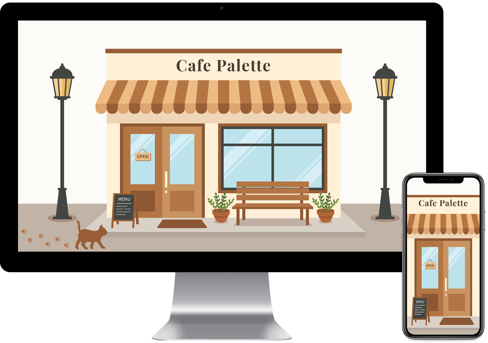

# Cafe Palette<!-- omit in toc -->

## 目次<!-- omit in toc -->
- [概要](#概要)
- [公開URL](#公開url)
- [目的](#目的)
- [こだわったポイント](#こだわったポイント)
- [使用技術](#使用技術)
- [使用フォント](#使用フォント)
- [デザインカンプ](#デザインカンプ)
- [各画面・機能紹介](#各画面機能紹介)
  - [リロード時のスクロール位置リセットと初期化制御](#リロード時のスクロール位置リセットと初期化制御)
  - [OPアニメーション](#opアニメーション)
    - [Promiseを用いた同期処理](#promiseを用いた同期処理)
  - [全体横スクロール](#全体横スクロール)
  - [ヘッダー](#ヘッダー)
    - [ボタン座標の動的計算と円形展開アニメーション（SP）](#ボタン座標の動的計算と円形展開アニメーションsp)
    - [非同期処理（async/await）によるスクロールロック制御（SP）](#非同期処理asyncawaitによるスクロールロック制御sp)
  - [FVセクション](#fvセクション)
    - [入店アニメーション（OPENモード）](#入店アニメーションopenモード)
    - [退店アニメーション（CLOSEモード）とSP時の固定解除制御](#退店アニメーションcloseモードとsp時の固定解除制御)
  - [前景レイヤー](#前景レイヤー)
    - [DrawSVGPluginを用いた黒板のチョーク描画アニメーション](#drawsvgpluginを用いた黒板のチョーク描画アニメーション)
    - [CSS変数による文字盤配置とスクロール連動の壁掛け時計](#css変数による文字盤配置とスクロール連動の壁掛け時計)
  - [背景レイヤー](#背景レイヤー)
    - [季節と時間帯を表現する5種類のCanvasパーティクル](#季節と時間帯を表現する5種類のcanvasパーティクル)
    - [デバイスピクセル比対応とデルタタイムによる描画エンジン](#デバイスピクセル比対応とデルタタイムによる描画エンジン)
  - [季節セクション（春・夏・秋・冬）](#季節セクション春夏秋冬)
    - [ポップアップ登場と浮遊ループのシームレスな連携](#ポップアップ登場と浮遊ループのシームレスな連携)
    - [スクロール固定とアニメーションのtransform競合回避](#スクロール固定とアニメーションのtransform競合回避)
  - [退店時ズームアニメーション](#退店時ズームアニメーション)
  - [Messageセクション](#messageセクション)
    - [スクロール進行度（progress）監視による時間差フェードイン](#スクロール進行度progress監視による時間差フェードイン)
  - [Infoセクション](#infoセクション)
  - [フッター](#フッター)

## 概要
架空のカフェ「Cafe Palette（カフェ パレット）」の季節限定メニューを紹介する特設サイトです。
「移りゆく季節の中で、変わらない一杯の温もりを。」をコンセプトに、朝の入店から春夏秋冬の移ろい、そして夜の退店までを1つの繋がったスクロールストーリーとして体験できるインタラクティブなWebサイトとして制作しました。

開発環境には **Vite** を採用し、**FLOCSS** に基づいたSCSS設計と **ES Modules** による機能単位のJavaScript分割を行っています。アニメーション実装には **GSAP**（ScrollTrigger / ScrollToPlugin / MorphSVGPlugin / DrawSVGPlugin）と **HTML5 Canvas** を組み合わせ、PC表示時は横スクロール、SP表示時は縦スクロールへとシームレスに切り替わるレスポンシブな演出を構築しています。

## 公開URL
[https://cafe-palette.mikanbako.jp/](https://cafe-palette.mikanbako.jp/)

## 目的
フロントエンドエンジニア／Webコーダーとしてのアニメーション実装力およびCSS・JavaScriptの設計力を証明するポートフォリオ作品として制作しました。
単なる動きの実装にとどまらず、保守性の高いコード設計やパフォーマンスへの配慮など、実務を見据えた以下のスキルをアピールすることを目的としています。

* **GSAPの各種プラグインとCanvasを駆使した高度なアニメーション実装力**

  `ScrollTrigger` によるスクロール連動制御をベースに、`MorphSVGPlugin`（パス変形）、`DrawSVGPlugin`（ストローク描画）、`ScrollToPlugin`（スムーススクロール）、さらに自作のCanvasパーティクルエンジンを組み合わせ、複数のレイヤーが連動するリッチな表現を実装しました。

* **PC（横スクロール）とSP（縦スクロール）に最適化したレスポンシブ設計**

  `gsap.matchMedia()` を活用し、ブレイクポイント（1024px）を境にPCでは `containerAnimation` を用いた横スクロール体験、SPでは操作性に優れた縦スクロール体験へと切り替わる設計を行いました。画面リサイズ時のクリーンアップ処理も徹底しています。

* **保守性・拡張性を意識したモジュール設計（ES Modules / FLOCSS / Handlebars）**

  JavaScriptは機能・セクション単位でモジュール分割し、カラーコードやイージング、ブレイクポイントなどを定数ファイル（`constants.js`）で一元管理しています。また、肥大化しやすいインラインSVGはHandlebarsを用いて外部ファイル化し、HTMLの可読性とメンテナンス性を高めました。

* **パフォーマンスとユーザー体験（UX）への徹底した配慮**

  非表示レイヤーにおけるCanvas描画ループの自動停止や、リサイズイベントのデバウンス処理、モニターのリフレッシュレートに依存しないデルタタイム計算など、ブラウザの負荷を抑えつつどの環境でも快適に動作する工夫を取り入れています。

## こだわったポイント
* **入店から退店まで「時間の流れと四季の移ろい」を体験できるストーリー演出**

  ただセクションを並べるのではなく、「昼間のカフェに入店し、店内で春・夏・秋・冬の限定メニューを楽しみ、夜になって雪の降る外へと退店する」という一連のストーリーを体験できるよう設計しました。季節ごとに背景色・舞い散るパーティクル・店内のクッション色・棚の雑貨・黒板のチョークアートが切り替わるほか、壁掛け時計の針が開店（10:00）から閉店（19:00）へと進み、退店時には外観が「夜の冬モード（窓の照明や雪だるま、雪道）」へと変化する細部の演出にこだわりました。

* **横スクロール（`containerAnimation`）環境下での疑似固定（逆スクロール）ロジック**

  PCの横スクロール中は、GSAPの仕様上、内部要素に対して標準の `pin: true` を使用することができません。そのため、全体のスクロール距離と各トリガー区間の比率から「要素を画面内に留めるために必要な逆方向の移動量（px）」を算出するユーティリティ関数（`getReverseScrollAmount`）を実装し、トラックが左へ動く分だけ対象要素を右へ移動させることで、横スクロール内での自然な画面固定を実現しました。

* **リフレッシュレート非依存＆高解像度（Retina）対応のCanvasパーティクルエンジン**

  背景で舞う桜・泡・落ち葉・粉雪・夜空の星は、オブジェクト指向（クラス設計）で実装したCanvasエンジンで描画しています。`window.devicePixelRatio` に合わせたスケーリングでスマホ等の高解像度画面でもボヤけない描画を保ちつつ、フレーム間の経過時間（`deltaTime`）を基に移動量や瞬きを計算することで、60Hz・120Hzなど異なるリフレッシュレートのモニター間でも同じ速度でアニメーションが再生されるよう制御しています。

* **`gsap.matchMedia()` のクリーンアップ関数による堅牢な状態管理**

  PCとSPを跨ぐ画面リサイズが発生した際に、スクロール連動のコールバック内で動的に付与されたインラインスタイルや進行中の単発Tweenが残って表示崩れを引き起こさないよう、各モジュールのクリーンアップ関数で `gsap.killTweensOf()` や `clearProps` を適切に実行し、初期状態へ安全にリセットする設計を徹底しました。

* **HandlebarsによるSVGの分割管理と、CSS変数を活用したスマートなUI構築**

  アニメーション制御のために多数のクラスやパスを持つインラインSVGを `src/svg/` 配下に分割し、ビルド時に `vite-plugin-handlebars` で結合する構成としました。また、壁掛け時計の文字盤配置やSPメニューの円形展開（`clip-path`）にはCSSカスタムプロパティ（CSS変数）を活用し、JavaScriptとCSSの役割分担を明確にしています。

## 使用技術
**フロントエンド**
* HTML
* Sass (SCSS)
* JavaScript (ES Modules)
* GSAP (ScrollTrigger, ScrollToPlugin, MorphSVGPlugin, DrawSVGPlugin)

**設計・開発環境**
* FLOCSS (CSSアーキテクチャ)
* Vite (ビルドツール)
* Node.js / npm (パッケージ管理)
* Stylelint (静的解析・コードフォーマッター)
* Handlebars (HTMLテンプレートエンジン / インラインSVGの分割・コンポーネント管理)

**インフラ・その他**
* さくらVPS
* Apache (Webサーバー)
* Git / GitHub (バージョン管理)

## 使用フォント
* [Playfair Display](https://fonts.google.com/specimen/Playfair+Display)
* [Shippori Mincho](https://fonts.google.com/specimen/Shippori+Mincho)

## デザインカンプ
[Figmaページ](https://www.figma.com/design/b0P1DBetkNb2B8MXXm0zrc/blog?node-id=2391-1375&t=W5m6luLXoAWFHqmm-1)（Figmaページへのリンクです。閲覧のみ可能です。）

## 各画面・機能紹介

本サイトの構成と、各セクションに実装している機能やこだわりポイントについて、実際の動き（webp動画）やスクリーンショットを交えながら紹介します。

### リロード時のスクロール位置リセットと初期化制御
`ScrollTrigger` を多用し複数の固定レイヤーを連動させる本サイトの構造上、ページの途中位置でブラウザのリロード（再読み込み）が行われると、スクロール位置の自動復元によってアニメーションの計算基準やレイヤーの表示状態にズレが生じる原因となります。
これを防ぐため、エントリーポイントである `main.js` の `setupScrollRestoration()` において、`history.scrollRestoration = 'manual'` でブラウザ標準のスクロール復元機能を無効化し、さらに `beforeunload` イベントで確実に最上部（`0, 0`）へリセットする制御を実装しました。
また、各モジュールの初期化関数（`init()`）の実行順序においても、後続の各セクションが `containerAnimation` として参照するページ全体の横スクロール処理（`initHorizontalScroll()`）を必ず先に生成してから各セクションの初期化を行うよう、依存関係を考慮した順序制御を行っています。

> 📂 **関連ファイル**
> * JS: [main.js](src/js/main.js)

### OPアニメーション

サイトアクセス時に最前面で再生されるオープニングアニメーションです。
円形に並んだ11個のドットが時差（`stagger`）を伴いながら回転・明滅するローディング演出からスタートし、読み込みが完了すると `MorphSVGPlugin` によって11個のドットが「Cafe Palette」の11文字のタイトルパスへと順番に変形します。最後は `clip-path: circle()` を用いて中央へ収縮するように幕が開き、ファーストビューが現れます。

#### Promiseを用いた同期処理
通信環境が高速な場合でもローディング演出が一瞬で消えてしまわないよう、`Promise.all` を用いて「ページの読み込み完了（`load` イベント）」と「最低表示時間（1.5秒）」の両方が完了するまで待機する処理を実装しました。
さらに、待機完了後も即座に変形へ移るのではなく、現在再生中のローディングアニメーションがちょうど1周の区切り（`onRepeat`）に達する瞬間を `Promise` で待ち受けてから一時停止させることで、回転の途中でカクッと切り替わることのない滑らかなアニメーション接続を実現しています。

> 📂 **関連ファイル**
> * JS: [opening.js](src/js/modules/opening.js)
> * SCSS: [_opening.scss](src/scss/object/project/_opening.scss)
> * SVG: [opening.html](src/svg/opening.html)

### 全体横スクロール

PC表示時（画面幅1024px以上）において、縦スクロール操作を横方向の移動へと変換する機能です。
外箱（`.l-scroll-container`）を `ScrollTrigger` の `pin: true` で画面に固定し、横一列に並べたメイントラック（`.l-main`）を左方向（マイナス方向）へ移動させています。
同時に、画面内に常時固定して見せたい「背景レイヤー」「前景レイヤー」「FVレイヤー」に対しては、メイントラックが左へ動く距離と全く同じ距離だけ右方向（プラス方向）へ逆スクロールさせることで、横スクロールコンテナ内部での画面固定を実現しています。

> 📂 **関連ファイル**
> * JS: [horizontal.js](src/js/modules/horizontal.js)
> * SCSS: [_main.scss](src/scss/layout/_main.scss)
> * SCSS: [_scroll-container.scss](src/scss/layout/_scroll-container.scss)

### ヘッダー

画面上部に常時固定されるヘッダーです。FVやInfoセクションではすりガラス調（`backdrop-filter: blur(2px)`）の背景を持ち、店内の前景レイヤーが表示される春〜冬セクションの間は `.is-transparent` クラスを付与して背景を完全透過させることで、カフェ店内の世界観を邪魔しないよう制御しています。
また、ナビゲーションリンクのクリック時には `ScrollToPlugin` を用い、PC時は「横スクロールの開始位置＋対象セクションの `offsetLeft`」を算出し、SP時は固定ヘッダーの高さを考慮した位置へとスムーススクロールします。

#### ボタン座標の動的計算と円形展開アニメーション（SP）
SP時のハンバーガーメニュー開閉では、ボタンの中心座標を `getBoundingClientRect()` で動的に取得してCSS変数（`--cx`, `--cy`）にセットし、その座標を起点として `clip-path: circle()` でメニュー背景が円形に広がるアニメーションを実装しました。画面リサイズ時にはデバウンス処理（`debounce.js`）を介して座標を再計算し、常にボタンの中心から展開されるよう制御しています。また、ボタンの三本線は `MorphSVGPlugin` でバツ印へと滑らかに変形します。

#### 非同期処理（async/await）によるスクロールロック制御（SP）
SPメニュー展開中は `body` に `.is-noscroll` クラスを付与して背面のスクロールを禁止しています。メニューを閉じる際には、`await tl.reverse()` によってタイムラインの逆再生完了を待機してから `.is-noscroll` クラスを解除することで、「メニューが完全に閉じ切る前に背面がスクロールできてしまう」という操作上の違和感を防いでいます。

> 📂 **関連ファイル**
> * JS: [header.js](src/js/modules/header.js)
> * JS: [common.js](src/js/modules/common.js)
> * JS: [debounce.js](src/js/utils/debounce.js)
> * SCSS: [_header.scss](src/scss/layout/_header.scss)
> * SVG: [header-hamburger.html](src/svg/header-hamburger.html)

### FVセクション

カフェの外観イラスト（SVG）とタイトルで構成されるセクションです。単なるファーストビューとしてだけでなく、サイト冒頭の「入店」と、全季節を巡った後の「退店」の2つのシーンで異なる表情を見せる役割を担っています。

#### 入店アニメーション（OPENモード）
初期状態（OPENモード）では、昼間の明るい日差しの中、「OPEN」の看板や観葉植物、店先を歩く猫と足跡が表示されています。スクロールを開始するとタイトルがフェードアウトし、入口のドアが奥へと開きながら店内へ向かってズームインすることで、実際にお店へ足を踏み入れるような没入感を演出しました。

#### 退店アニメーション（CLOSEモード）とSP時の固定解除制御
Messageセクションを通過した後の退店トリガー区間では、FVレイヤーを外観の「CLOSEモード（夜・冬仕様）」に切り替えて再表示します。看板が「CLOSE」に変わり、観葉植物が雪だるまに、道路が雪道カラーに変化し、猫が姿を消して窓ガラスや店内に温かい照明が灯る中、ドアが閉まりながらズームアウトしていく逆再生アニメーションが進行します。
またSP表示時は、退店アニメーションが完了した地点でFVの `position: fixed` を `absolute` へと動的に切り替えてInfoセクションの直上に配置することで、固定レイヤーでありながら後続のInfoセクションへと自然に縦スクロールで遷移できる仕組みを構築しました。

> 📂 **関連ファイル**
> * JS: [fv.js](src/js/modules/fv.js)
> * SCSS: [_fv.scss](src/scss/object/project/_fv.scss)
> * SVG: [fv-exterior-pc.html](src/svg/fv-exterior-pc.html)
> * SVG: [fv-exterior-sp.html](src/svg/fv-exterior-sp.html)

### 前景レイヤー

春〜冬セクションの間、画面手前に固定表示されるカフェ店内の装飾レイヤーです。大きな窓枠やテーブル、コーヒーカップに加え、季節の移り変わりに合わせてイスのクッションカラーや壁面の棚のディスプレイアイテム（桜の盆栽や夏のヨット・麦わら帽子、秋のランタン、冬のキャンドルやスノードームなど）がフェードで切り替わります。

#### DrawSVGPluginを用いた黒板のチョーク描画アニメーション
店内左側に配置された黒板には、各季節のタイトルとイラストがチョークで描かれるアニメーションを実装しました。`DrawSVGPlugin` を用い、文字のパスを1文字ずつ「輪郭線でなぞって描く（`drawSVG: "0%" -> "100%"`）➔ チョーク色で塗りつぶす」という順序で実行し、最後に装飾イラストを描画することで、スクロールに合わせて実際にチョークで文字を書いているような演出を行っています。

#### CSS変数による文字盤配置とスクロール連動の壁掛け時計
店内右上の壁掛け時計は、HTML側で各数字に付与したインラインCSS変数（`--i: 1`〜`12`）とSCSSの `calc()` を組み合わせ、`rotate(calc(30deg * var(--i)))` で角度をつけつつ半径分外側へ移動させ、最後に逆回転で文字の向きを垂直に戻すことで、1つの計算式で12個の数字を円周上に配置しています。
また、カフェの営業時間（10:00〜19:00）を基に長針・短針の開始角度と総回転角度をJavaScriptで算出し、春から冬へとスクロールが進むにつれて店内の時間がゆっくりと経過していく演出を取り入れました。

> 📂 **関連ファイル**
> * JS: [foreground.js](src/js/modules/foreground.js)
> * SCSS: [_foreground.scss](src/scss/layout/_foreground.scss)
> * SCSS: [_clock.scss](src/scss/object/project/_clock.scss)
> * SVG: [foreground-pc.html](src/svg/foreground-pc.html)
> * SVG: [foreground-sp.html](src/svg/foreground-sp.html)

### 背景レイヤー

店内の窓の奥（画面最背面）に広がる景色を表現するレイヤーです。`MorphSVGPlugin` によって常時ゆったりと波打ち続けるSVGの波と、スクロール位置に応じて切り替わる季節のテーマカラー、そしてHTML5 Canvasで描画されるパーティクルアニメーションを重ね合わせて構成しています。

#### 季節と時間帯を表現する5種類のCanvasパーティクル
各シーンの空気感を表現するため、挙動や描画方法が異なる5つのパーティクルクラス（`particles.js`）を実装しました。
* **春（`Petal`）**：回転しながら斜め下へとゆったり舞い落ちる桜の花びら
* **夏（`Bubble`）**：画面下から上へと爽やかに浮かび上がる半透明の泡
* **秋（`Leaf`）**：3色の紅葉カラーからランダムに生成され、揺れながら舞い落ちる落ち葉
* **冬（`Snow`）**：静かに降り積もる白い粉雪
* **夜（`Star`）**：退店時〜Infoセクションで夜空に浮かぶ星。位置は固定したまま、正弦波（`Math.sin`）を用いてサイズ・明度・透明度を周期的に変化させることで、夜空でキラキラと瞬く表現を実装しました。

#### デバイスピクセル比対応とデルタタイムによる描画エンジン
Canvasの描画管理を行う `canvasEngine.js` では、`window.devicePixelRatio` を考慮してCanvasの実画素数とコンテキストのスケールを調整し、Retinaディスプレイ等の高解像度環境でもパーティクルが鮮明に描画されるようにしました。
また、`requestAnimationFrame` のタイムスタンプからフレーム間の経過時間（`deltaTime`）を算出し、「1秒あたりの移動速度 × 経過秒数」で座標を更新することで、モニターのリフレッシュレートに関わらず一定の速度でアニメーションが再生されます。背景レイヤーが非表示になる区間では自動的にアニメーションループを停止（`cancelAnimationFrame`）し、無駄なCPU/GPU負荷を抑えています。

> 📂 **関連ファイル**
> * JS: [background.js](src/js/modules/background.js)
> * JS: [canvasEngine.js](src/js/modules/canvasEngine.js)
> * JS: [particles.js](src/js/modules/particles.js)
> * JS: [debounce.js](src/js/utils/debounce.js)
> * SCSS: [_background.scss](src/scss/layout/_background.scss)
> * SVG: [background-wave.html](src/svg/background-wave.html)

### 季節セクション（春・夏・秋・冬）

カフェの窓辺（前景レイヤー）と季節の景色（背景レイヤー）に挟まれながら、春夏秋冬それぞれの季節限定メニュー（生成AIのGeminiで作成したメニュー画像とキャッチコピー）を紹介するメインセクションです。

#### ポップアップ登場と浮遊ループのシームレスな連携
各季節のエリアに進入すると、`elastic.out` イージングによってメニュー画像とキャッチコピーが弾むようにポップアップ登場します。さらに同じタイムラインの末尾に `GSAP_EASING.FLOAT`（`sine.inOut`）を用いた上下移動（`yoyo: true, repeat: -1`）を繋げることで、ポップアップ完了後にそのまま切れ目なくふわふわと漂う無限ループアニメーションへと移行させています。

#### スクロール固定とアニメーションのtransform競合回避
セクション通過中にメニューコンテンツを画面中央に固定する際、SP時はScrollTriggerの `pin` 機能、PC時は逆スクロール移動（`x` 座標の移動）によって外枠（`.js-season-content`）の `transform` が操作されます。そこで、固定制御は外枠の要素に専念させ、ポップアップや浮遊ループのアニメーションは内側の画像（`.js-season-image`）とテキスト（`.js-season-text`）に対して直接適用することで、GSAPにおける `transform` プロパティの競合（位置ズレや上書き）を完全に回避しました。

> 📂 **関連ファイル**
> * JS: [season.js](src/js/modules/season.js)
> * JS: [scroll.js](src/js/utils/scroll.js)
> * SCSS: [_season-panel.scss](src/scss/object/project/_season-panel.scss)

### 退店時ズームアニメーション

冬のセクションを通過した後、次のMessageセクションへと場面転換するためのトランジション演出です。
前景レイヤーのテーブル中央に置かれた「コーヒーカップ」の座標を `transformOrigin` に指定し、スクロールに合わせて前景レイヤー全体を150倍（PC）／300倍（SP）まで拡大（ディープズーム）させています。後半にかけて急激に加速する `expo.in` イージングを用いることで、コーヒーカップの中へと吸い込まれるように画面全体がエスプレッソ色（`#3e2723`）で満たされ、同じ背景色を持つMessageセクションへと継ぎ目なく遷移します。

> 📂 **関連ファイル**
> * JS: [exit.js](src/js/modules/exit.js)

### Messageセクション

コーヒーカップの中へズームインした直後のエスプレッソ色の画面上で、カフェのコンセプトメッセージを伝えるセクションです。背景では `filter: blur(4px)` で柔らかくぼかした湯気のSVGが `MorphSVGPlugin` によってゆらゆらと立ち昇り続け、温かなコーヒーの余韻を表現しています。

#### スクロール進行度（progress）監視による時間差フェードイン
このセクションでは、文字や湯気の透明度をスクロール量にそのまま直結（`scrub`）させるのではなく、`ScrollTrigger` の `onUpdate` コールバック内でスクロール進行度（`self.progress`）を監視する手法を採りました。
進行度が `0.2` を超えた瞬間に湯気、`0.5` を超えた瞬間にメッセージテキストをそれぞれ固有の再生時間（`duration: 1.6`）でフワッと浮かび上がらせることで、ユーザーのスクロール速度が速い場合でも情緒的なフェードイン演出をじっくり見せられるよう工夫しています。

> 📂 **関連ファイル**
> * JS: [message.js](src/js/modules/message.js)
> * JS: [scroll.js](src/js/utils/scroll.js)
> * SCSS: [_message.scss](src/scss/object/project/_message.scss)
> * SVG: [message-steam.html](src/svg/message-steam.html)

### Infoセクション

退店アニメーションで夜のカフェを後にした後に訪れる、店舗情報（住所・営業時間・定休日）とGoogleマップを掲載したセクションです。
このセクション自身には背景色を設定せず、背面に固定されている背景レイヤー（夜空の背景色とキラキラ瞬く星のパーティクル）がそのまま透けて見えるレイヤー構造としています。また、埋め込んだGoogleマップ（`iframe`）が夜空の落ち着いたトーン＆マナーから浮いてしまわないよう、CSSの `filter: grayscale(20%) contrast(90%)` を適用して彩度とコントラストを微調整しました。

> 📂 **関連ファイル**
> * SCSS: [_info.scss](src/scss/object/project/_info.scss)

### フッター

ページの最下部（PC時は横スクロールの最右端パネル）に配置されるフッターです。
クリックするとページ最上部（先頭）へスムーススクロールで戻るサイトロゴ、各セクションへ移動できるナビゲーションリンク、季節限定メニュー画像に関する生成AI（Gemini）使用の注記、およびコピーライトを中央揃えで配置しています。SP表示時には注記テキストが不自然な位置で折り返されないよう、ブレイクポイントに応じた改行制御（`.l-footer__br`）も取り入れています。

> 📂 **関連ファイル**
> * SCSS: [_footer.scss](src/scss/layout/_footer.scss)